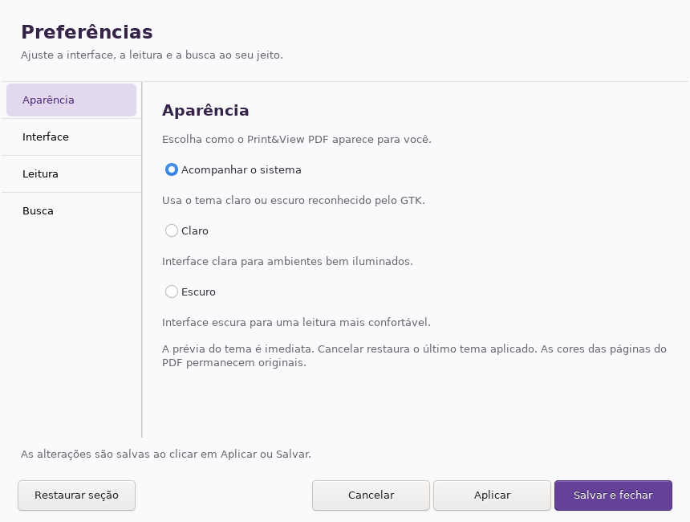

# Print&View PDF

Leitor de PDFs com busca progressiva, apresentação e preparação de impressão em
livreto, pôster e várias páginas por folha. É a continuação do Winux PDF.

**Linux atual: 3.4.1** · **Windows disponível: 3.4.0**

[Downloads](https://github.com/airtonbp19edu/Print-and-View-PDF/releases/tag/v3.4.1) · [Instalação](#instalação) · [Documentação](docs/README.md) · [Histórico](CHANGELOG.md) · [Testes e evidências](docs/validation/3.4.1/README.md)

## Downloads

| Sistema | Versão | Download |
|---|---|---|
| Debian/Ubuntu | 3.4.1 | [Pacote .deb](https://github.com/airtonbp19edu/Print-and-View-PDF/releases/download/v3.4.1/print-view-pdf_3.4.1_all.deb) |
| Linux x86_64 com Flatpak | 3.4.1 | [Bundle .flatpak](https://github.com/airtonbp19edu/Print-and-View-PDF/releases/download/v3.4.1/PrintViewPDF-3.4.1-x86_64.flatpak) |
| Windows 10/11 x64 | 3.4.0 | [Instalador .exe](packages/PrintViewPDF-3.4.0-Setup-x64.exe) |

Os novos pacotes Linux ficam em **Releases**. O instalador Windows 3.4.0 é anterior
à central de preferências. Os artefatos antigos foram preservados em
[packages/](packages/README.md).

Confira os arquivos Linux com o [SHA256SUMS da release](https://github.com/airtonbp19edu/Print-and-View-PDF/releases/download/v3.4.1/SHA256SUMS):

```bash
sha256sum -c SHA256SUMS
```

## Novidades da versão Linux 3.4.1

- Central de **Aparência, Interface, Leitura e Busca**, pela engrenagem,
  **Arquivo → Preferências** ou **Ctrl+,**.
- Prévia de tema com Cancelar, Aplicar, Salvar e fechar e restauração por seção.
- Padrões de zoom, memória opcional por PDF e persistência das opções de busca.
- Correções do runtime Flatpak: bibliotecas isoladas, subprocessos Python com o
  carregador correspondente e provedor OpenSSL incluído.



Veja as [outras seções e o comportamento completo](docs/PREFERENCIAS-PRIMEIRA-IMPLEMENTACAO.md).

## Recursos do leitor

- Navegação, zoom, rotação, miniaturas, marcadores, comentários e consulta de camadas.
- Busca progressiva com resultados, contexto, navegação e opções de caixa,
  palavra inteira, acentos e hifenização.
- Temas claro, escuro e do sistema; a aparência do PDF permanece original.
- Apresentação com ajuste de página/largura, modo de leitura, pan e laser.
- Seleção e cópia por palavras; exportação de PNG e salvamento de PDF preparado.
- Impressão em tamanho, N-up, livreto e pôster, com navegação das faces do livreto.

No Linux, a impressão usa CUPS. No Windows, o documento preparado é enviado ao
diálogo nativo de impressão; propriedades avançadas dependem do driver.

## Instalação

### Debian/Ubuntu

Depois de baixar o pacote na release:

```bash
sudo apt install ./print-view-pdf_3.4.1_all.deb
print-view-pdf
```

As dependências são instaladas pelo apt. A associação padrão de PDFs não é
alterada automaticamente.

### Flatpak

```bash
flatpak remote-add --user --if-not-exists flathub https://dl.flathub.org/repo/flathub.flatpakrepo
flatpak install --user flathub org.freedesktop.Platform//25.08
flatpak install --user ./PrintViewPDF-3.4.1-x86_64.flatpak
flatpak run io.github.airtonbp19edu.PrintViewPDF
```

O bundle inclui Python, GTK e ferramentas PDF. O runtime Freedesktop é instalado
pelo Flatpak. O aplicativo acessa a pasta pessoal, o display e CUPS/rede para
impressão. Esta distribuição é por GitHub Releases; não é publicação no Flathub.

### Windows

Execute o instalador 3.4.0. Python, GTK e Poppler estão incluídos; a instalação
é por usuário. O instalador não possui assinatura Authenticode. Para avaliar as
preferências novas a partir da fonte, consulte o [guia de desenvolvimento](docs/DESENVOLVIMENTO.md).

## Validação e limites

No Debian 13.7 x86_64 foram executados **41 casos por contexto**: fonte,
Debian instalado e Flatpak instalado **dentro do sandbox real**. Em cada execução:
**40 aprovados, zero falhas/erros e um caso exclusivo do Windows ignorado**.
Os lançadores padrão também passaram pelo teste de inicialização.

Os 83 arquivos da aplicação e os 2.973 arquivos do payload Flatpak instalado
foram conferidos. Consulte o [relatório de entrega](docs/ENTREGA-3.4.1-LINUX.md)
e as [evidências completas](docs/validation/3.4.1/README.md).

Impressão física, Wayland/desktop real, outras distribuições e PDFs grandes
continuam sem validação nesta entrega. OCR, edição de PDF e seleção precisa por
caracteres não estão implementados. Não há alegação de equivalência integral
com Foxit ou UPDF. A regressão Windows completa continua pendente.

## Código e desenvolvimento

| Pasta | Conteúdo |
|---|---|
| [app/](app/) | Aplicação Python/GTK e pypdf vendorizado |
| [assets/](assets/) | Ícones e integração com o desktop |
| [scripts/](scripts/) | Execução, prévia e empacotamento |
| [tests/](tests/) | Persistência, busca, renderização, impressão e interface |
| [packaging/](packaging/) | Metadados e configuração dos instaladores |
| [docs/](docs/README.md) | Guias, entregas, evidências e histórico |

Comece pelo [guia de desenvolvimento](docs/DESENVOLVIMENTO.md).
Contribuições: [CONTRIBUTING.md](CONTRIBUTING.md).

## Licenças e histórico

O aplicativo usa a licença [MIT](LICENSE). O pypdf **6.20.1** está fixado em
app/vendor, com [licença BSD-3-Clause](docs/pypdf-LICENSE.txt).
As notas das bibliotecas incluídas são preservadas pelos empacotadores.

A [revisão do Winux](docs/REVISAO-HISTORICO-WINUX.md) registra a origem dos
recursos. A [análise estática de Foxit e UPDF](docs/ENGENHARIA-REVERSA-FOXIT-UPDF.md)
é parcial; o aplicativo não incorpora código ou recursos desses leitores.
